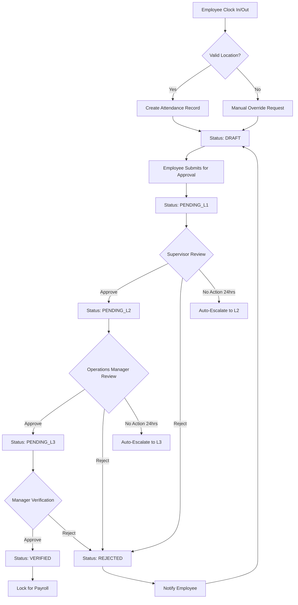

I'll provide you with a comprehensive PRD using GraphQL API architecture. This will be a complete document incorporating all the features we've discussed.

# Product Requirements Document (PRD)
## HRFlow Pro - Comprehensive HR Management System
### Version 2.0 with GraphQL API Architecture

---

## Table of Contents
1. [Executive Summary](#1-executive-summary)
2. [Product Overview](#2-product-overview)
3. [User Personas](#3-user-personas)
4. [Functional Requirements](#4-functional-requirements)
5. [GraphQL API Architecture](#5-graphql-api-architecture)
6. [Non-Functional Requirements](#6-non-functional-requirements)
7. [Technical Architecture](#7-technical-architecture)
8. [Data Models](#8-data-models)
9. [Business Rules & Workflows](#9-business-rules-workflows)
10. [Security & Compliance](#10-security-compliance)
11. [Success Metrics](#11-success-metrics)
12. [Implementation Roadmap](#12-implementation-roadmap)
13. [Risk Assessment](#13-risk-assessment)

---

## 1. Executive Summary

**Product Name:** HRFlow Pro  
**Version:** 2.0  
**Date:** November 2024  
**Product Type:** Enterprise HR Management System with Mobile App and Web Admin Portal

### Vision Statement
Create a comprehensive, GraphQL-powered HR management platform that seamlessly handles employee attendance with multi-level approvals, leave management, client location tracking, contract management, and payroll processing through an intuitive mobile experience and powerful admin portal.

### Key Differentiators
- **GraphQL API:** Flexible, efficient data fetching with real-time subscriptions
- **Multi-Level Approval Workflows:** Three-tier approval for attendance and leave
- **Multi-Location Client Management:** Track employees across multiple client sites
- **Real-Time Location Intelligence:** GPS-based attendance with geofencing
- **Integrated Payroll Engine:** Automated payroll with approval dependencies

---

## 2. Product Overview

### 2.1 Problem Statement
Organizations managing distributed workforces across multiple client locations struggle with:
- Fragmented HR systems requiring multiple tools
- Manual approval processes causing payroll delays
- Lack of real-time visibility into employee locations
- Compliance challenges across different client sites
- Inefficient paper-based contract management

### 2.2 Solution Architecture
```
┌─────────────────────────────────────────────────────┐
│                   Frontend Layer                      │
├────────────────┬────────────────┬───────────────────┤
│  Mobile App    │  Web Admin      │  Client Portal    │
│  (React Native)│  (React.js)     │  (Next.js)        │
└────────────────┴────────────────┴───────────────────┘
                          │
                    GraphQL Gateway
                    (Apollo Server)
                          │
┌─────────────────────────────────────────────────────┐
│                  Microservices                        │
├──────────┬──────────┬──────────┬──────────┬────────┤
│Attendance│  Leave   │ Location │  Payroll │Contract│
│ Service  │ Service  │ Service  │ Service  │Service │
└──────────┴──────────┴──────────┴──────────┴────────┘
                          │
┌─────────────────────────────────────────────────────┐
│              Data Layer (PostgreSQL)                  │
└─────────────────────────────────────────────────────┘
```

---

## 3. User Personas

### Primary Personas

#### 3.1 Field Employee (Mobile App User)
- **Profile:** On-site workers at client locations
- **Needs:** Quick clock-in/out, view schedules, request leaves, access payslips
- **Pain Points:** Complex attendance systems, delayed approvals, no mobile access
- **Device:** Smartphone (Android/iOS)

#### 3.2 Direct Supervisor
- **Profile:** Team leads managing 10-20 employees
- **Needs:** Approve attendance/leave, monitor team presence, manage schedules
- **Pain Points:** Manual tracking, no real-time visibility, paperwork overload
- **Device:** Mobile and Desktop

#### 3.3 Operations Manager
- **Profile:** Manages multiple teams across locations
- **Needs:** Department oversight, resource allocation, compliance monitoring
- **Pain Points:** Lack of consolidated view, manual reports, approval bottlenecks
- **Device:** Primarily Desktop

#### 3.4 HR Manager
- **Profile:** Handles payroll, compliance, and administration
- **Needs:** Process payroll, generate reports, manage contracts, ensure compliance
- **Pain Points:** Manual data entry, multiple systems, audit challenges
- **Device:** Desktop

#### 3.5 C-Level Executive
- **Profile:** Strategic decision makers
- **Needs:** High-level dashboards, cost analysis, compliance status
- **Pain Points:** Lack of real-time insights, delayed reports
- **Device:** Desktop and Tablet

---

## 4. Functional Requirements

### 4.1 Mobile Application Features

#### 4.1.1 Authentication & Security

**Phase 1 (MVP):**
```
Primary Authentication:
├── Email/Password Authentication
├── JWT Token Management
├── Session Management
├── Secure Token Storage
└── Auto-logout on Inactivity
```

**Phase 2 (Enhanced Security):**
```
Additional Features:
├── Biometric Authentication (Face ID/Fingerprint)
├── PIN Quick Access
├── Two-Factor Authentication (2FA/MFA)
└── Advanced Threat Detection
```

**Implementation Priority:**
1. Email/Password with secure password hashing (bcrypt)
2. JWT access tokens (1 hour expiry) + refresh tokens (7 days)
3. Session management with Redis
4. Basic security features (rate limiting, account lockout)
5. Biometric authentication (Phase 2)
6. Two-factor authentication (Phase 2)

#### 4.1.2 Attendance Management with Approval Workflow

**Clock In/Out Process:**
```
Employee Action → GPS Verification → Time Capture → Submit for Approval
                                          ↓
                            Supervisor Review (Level 1)
                                          ↓
                        Operations Manager Approval (Level 2)
                                          ↓
                          Manager Verification (Level 3)
                                          ↓
                             Locked for Payroll
```

**Mobile Interface Features:**
- GPS-based clock in/out with geofencing
- Multiple location check-in for same day
- Attendance calendar view
- Status tracking through approval stages
- Push notifications for approval updates
- Offline mode with sync capability

**Attendance Status Indicators:**
- 🟡 Draft - Not submitted
- 🔵 Pending Supervisor
- 🟣 Pending Operations Manager
- 🟠 Pending Manager Verification
- 🟢 Verified for Payroll
- 🔴 Rejected - Action required

#### 4.1.3 Leave Management with Approval Workflow

**Leave Request Features:**
- Multiple leave types (Annual, Sick, Emergency, Unpaid, etc.)
- Balance checking before submission
- Team calendar visibility
- Document attachment support
- Handover notes and backup assignment
- Same three-tier approval as attendance

#### 4.1.4 Location Services

**GPS Geofencing Configuration:**
- **Standard Radius**: 100 meters (balanced accuracy)
- **Accuracy Tolerance**: Works in most environments with GPS drift compensation
- **Indoor Handling**: May require manual verification in dense buildings
- **Override Capability**: Location-specific radius adjustment available
- **Validation**: Real-time distance calculation from coordinates

**Client Location Features:**
```
Current Assignment Display
├── Client Name & Location
├── Site Address with Map
├── Distance from Location (GPS-based)
├── Geofence Status (Within 100m / Outside)
├── Site Contact Details
├── Emergency Numbers
└── Quick Actions
    ├── Navigate to Site
    ├── Call Supervisor
    ├── Report Issue
    └── Request Transfer
```

#### 4.1.5 Employee Self-Service
- Personal information management
- Document upload/download
- Payslip access (current & historical)
- Contract viewing
- Company directory
- Organization chart
- Internal announcements

### 4.2 Web Admin Portal Features

#### 4.2.1 Dashboard & Analytics

**Executive Dashboard Layout:**
```
┌──────────────────────────────────────────────────────┐
│                  Real-Time Metrics                    │
├─────────────┬──────────────┬─────────────┬──────────┤
│ Attendance  │ On Leave     │ Deployed    │ Payroll  │
│ 95.2%       │ 23 employees │ 420/450     │ $2.3M    │
└─────────────┴──────────────┴─────────────┴──────────┘

┌──────────────────────────────────────────────────────┐
│              Pending Approvals Summary                │
├──────────────────────────────────────────────────────┤
│ Attendance: 45 | Leave: 12 | Transfers: 5            │
└──────────────────────────────────────────────────────┘

┌──────────────────────────────────────────────────────┐
│            Client Location Distribution               │
│ [Interactive Map with Employee Deployment]           │
└──────────────────────────────────────────────────────┘
```

#### 4.2.2 Multi-Level Approval Management

**Approval Workflow Configuration:**
```javascript
{
  "approvalChain": {
    "attendance": {
      "level1": {
        "role": "Supervisor",
        "sla": "24 hours",
        "autoEscalate": true,
        "bulkApproval": true
      },
      "level2": {
        "role": "OperationsManager",
        "sla": "24 hours",
        "autoEscalate": true,
        "requiresComment": false
      },
      "level3": {
        "role": "Manager",
        "sla": "24 hours",
        "autoEscalate": false,
        "locksForPayroll": true
      }
    }
  }
}
```

#### 4.2.3 Client & Location Management

**Multi-Location Assignment Strategy:**
- **Multiple Active Assignments**: Employees can have multiple concurrent location assignments
- **Daily Location Tracking**: Attendance records track which specific location was worked each day
- **Primary Location**: Employees have a designated primary location for default assignment
- **Flexible Deployment**: Support for employees working across multiple sites
- **Real-Time Tracking**: GPS coordinates confirm actual work location daily

**Multi-Location Client Structure:**
```
Client Contract: CT-2024-001
├── Contract Information
│   ├── Contract Number: CT-2024-001
│   ├── Client: ABC Corporation (CL-2024-001)
│   ├── Contract Value: $5,000,000 USD
│   ├── Duration: Jan 2024 - Dec 2026 (36 months)
│   ├── Status: ACTIVE
│   ├── Auto-Renew: Yes
│   └── Primary Contact: John Doe
│
├── Personnel Requirements
│   ├── Total Required: 95 personnel
│   ├── Gender Requirement: MIXED
│   ├── Male Personnel: 70
│   ├── Female Personnel: 25
│   ├── Currently Deployed: 95/95 (100%)
│   └── Deployment Status: FULLY_STAFFED
│
├── Location Coverage
│   ├── Number of Locations: 3
│   ├── All Locations Active: ✓
│   └── Coverage Status: 100%
│
├── Location 1: Headquarters (Primary)
│   ├── Location Code: LOC-HQ-001
│   ├── Address: 123 Business Ave, NYC
│   ├── Required Personnel: 50 (30M / 20F)
│   ├── Currently Deployed: 50/50 (100%)
│   ├── Active Assignments: 50 (some multi-location)
│   ├── Shift Patterns: 3 (Morning/Evening/Night)
│   ├── Geofence: 100m radius
│   └── Site Manager: Jane Smith
│
├── Location 2: Warehouse
│   ├── Location Code: LOC-WH-001
│   ├── Address: 456 Industrial Rd, NJ
│   ├── Required Personnel: 30 (25M / 5F)
│   ├── Currently Deployed: 30/30 (100%)
│   ├── Active Assignments: 35 (5 multi-location from HQ)
│   ├── Shift Patterns: 2 (Day/Night)
│   ├── Geofence: 100m radius
│   └── Site Manager: Bob Johnson
│
└── Location 3: Regional Office
    ├── Location Code: LOC-RO-001
    ├── Address: 789 Office Park, NYC
    ├── Required Personnel: 15 (15M / 0F - Male Only)
    ├── Currently Deployed: 15/15 (100%)
    ├── Active Assignments: 17 (2 multi-location)
    ├── Shift Patterns: 2 (Day/Night)
    ├── Geofence: 100m radius
    └── Site Manager: Sarah Williams

Contract Performance Metrics:
├── Staffing Compliance: 100% (95/95 deployed)
├── Gender Compliance: 100% (70M + 25F as required)
├── Location Coverage: 100% (3/3 locations active)
├── Contract Utilization: $4,200,000 / $5,000,000 (84%)
└── Renewal Date: December 31, 2026 (Auto-renew enabled)
```

**Multi-Location Employee Example:**
```
Employee: John Doe (EMP-001)
Active Assignments:
├── Primary: ABC Corp HQ (Mon-Wed)
├── Secondary: ABC Corp Warehouse (Thu-Fri)
└── Coverage: Regional Office (as needed)

Attendance Tracking:
├── 2024-11-15: ABC Corp HQ ✓
├── 2024-11-16: ABC Corp HQ ✓
├── 2024-11-17: ABC Corp Warehouse ✓ (GPS verified)
└── Daily records maintain location specificity
```

#### 4.2.4 Payroll Processing

**Payroll Workflow:**
1. Attendance Verification Check
2. Leave Balance Deduction
3. Overtime Calculation
4. Tax Computation
5. Deductions Processing
6. Net Salary Calculation
7. Bank File Generation
8. Payslip Distribution

#### 4.2.5 Contract Management

**Features:**
- Employee contract lifecycle
- Client contract tracking
- Digital signature integration
- Renewal alerts and automation
- Template management
- Version control
- Bulk generation

---

## 5. GraphQL API Architecture

### 5.1 Schema Overview

```graphql
# Root Schema Definition
schema {
  query: Query
  mutation: Mutation
  subscription: Subscription
}

# Scalar Types
scalar DateTime
scalar Date
scalar Time
scalar JSON
scalar Upload
scalar Decimal
```

### 5.2 Core Type Definitions

```graphql
# User and Authentication Types
type User {
  id: ID!
  email: String!
  role: UserRole!
  employee: Employee
  permissions: [Permission!]!
  createdAt: DateTime!
  updatedAt: DateTime!
}

enum UserRole {
  SUPER_ADMIN
  HR_MANAGER
  OPERATIONS_MANAGER
  SUPERVISOR
  EMPLOYEE
  CLIENT_VIEWER
}

type Employee {
  id: ID!
  employeeCode: String!
  firstName: String!
  lastName: String!
  email: String!
  phone: String
  department: Department!
  designation: Designation!
  supervisor: Employee
  currentLocations: [LocationAssignment!]!  # Multiple active locations supported
  primaryLocation: LocationAssignment       # Primary/default location
  attendanceRecords(filter: AttendanceFilter): [Attendance!]!
  leaveRequests(filter: LeaveFilter): [LeaveRequest!]!
  payslips(year: Int, month: Int): [Payslip!]!
  contracts: [EmployeeContract!]!
}

# Client and Location Types
type Client {
  id: ID!
  clientCode: String!
  companyName: String!
  contracts: [ClientContract!]!
  locations: [ClientLocation!]!
  primaryContact: ContactPerson!
  isActive: Boolean!
}

type ClientContract {
  id: ID!
  client: Client!
  contractNumber: String!
  startDate: Date!
  endDate: Date!
  contractValue: Decimal!
  contractPeriodMonths: Int!
  requiredPersonnel: Int!
  genderRequirement: GenderRequirement!
  maleCount: Int
  femaleCount: Int
  numberOfLocations: Int!
  locations: [ClientLocation!]!
  paymentTerms: String
  slaTerms: String
  autoRenew: Boolean!
  status: ContractStatus!
  signedDocumentUrl: String
  createdAt: DateTime!
  updatedAt: DateTime!
}

enum GenderRequirement {
  MALE_ONLY
  FEMALE_ONLY
  MIXED
  NO_PREFERENCE
}

enum ContractStatus {
  DRAFT
  PENDING_APPROVAL
  ACTIVE
  EXPIRING_SOON
  EXPIRED
  TERMINATED
  RENEWED
}

type ClientLocation {
  id: ID!
  locationCode: String!
  locationName: String!
  client: Client!
  address: Address!
  coordinates: Coordinates!
  geofenceRadius: Int!
  operationalDetails: LocationOperations!
  deployedEmployees: [Employee!]!
  staffingRequirements: [StaffingRequirement!]!
  attendanceToday: LocationAttendanceStats!
}

type LocationAssignment {
  id: ID!
  employee: Employee!
  client: Client!
  location: ClientLocation!
  roleAtSite: String!
  startDate: Date!
  endDate: Date
  shiftPattern: ShiftPattern!
  isCurrent: Boolean!
}

# Attendance Types
type Attendance {
  id: ID!
  employee: Employee!
  date: Date!
  clockIn: DateTime
  clockOut: DateTime
  location: ClientLocation!
  status: AttendanceStatus!
  approvalStage: ApprovalStage!
  approvals: [AttendanceApproval!]!
  totalHours: Decimal
  overtimeHours: Decimal
  remarks: String
}

enum AttendanceStatus {
  DRAFT
  PENDING_L1
  PENDING_L2
  PENDING_L3
  VERIFIED
  REJECTED
  LOCKED_FOR_PAYROLL
}

type AttendanceApproval {
  id: ID!
  level: Int!
  approver: User!
  status: ApprovalStatus!
  comments: String
  approvedAt: DateTime
  attendance: Attendance!
}

# Leave Management Types
type LeaveRequest {
  id: ID!
  employee: Employee!
  leaveType: LeaveType!
  startDate: Date!
  endDate: Date!
  totalDays: Decimal!
  reason: String!
  status: LeaveStatus!
  approvals: [LeaveApproval!]!
  attachments: [Attachment!]
  backupPerson: Employee
  createdAt: DateTime!
}

type LeaveType {
  id: ID!
  name: String!
  code: String!
  paidLeave: Boolean!
  requiresDocument: Boolean!
  maxDaysAllowed: Int
  carryForwardAllowed: Boolean!
}

type LeaveBalance {
  id: ID!
  employee: Employee!
  leaveType: LeaveType!
  entitled: Decimal!
  taken: Decimal!
  pending: Decimal!
  available: Decimal!
  year: Int!
}

# Payroll Types
type Payslip {
  id: ID!
  employee: Employee!
  month: Int!
  year: Int!
  basicSalary: Decimal!
  allowances: [Allowance!]!
  deductions: [Deduction!]!
  grossSalary: Decimal!
  netSalary: Decimal!
  taxAmount: Decimal!
  attendanceDays: Int!
  overtimePay: Decimal
  pdfUrl: String!
  status: PayslipStatus!
}

enum PayslipStatus {
  DRAFT
  PROCESSING
  APPROVED
  PUBLISHED
  PAID
}

# Payroll Error Handling
type UnlockPayrollResult {
  successful: Int!
  failed: Int!
  unlockedAttendance: [Attendance!]!
  errors: [UnlockError!]
  auditLogEntries: [AuditLog!]!
}

type UnlockError {
  attendanceId: ID!
  errorMessage: String!
  errorCode: String!
}

type AuditLog {
  id: ID!
  userId: ID!
  action: String!
  entityType: String!
  entityId: ID!
  reason: String
  timestamp: DateTime!
  ipAddress: String
}
```

### 5.3 Query Operations

```graphql
type Query {
  # Authentication Queries
  me: User!
  validateToken(token: String!): TokenValidation!
  
  # Employee Queries
  employee(id: ID, employeeCode: String): Employee
  employees(
    filter: EmployeeFilter
    pagination: PaginationInput
    sort: SortInput
  ): EmployeeConnection!
  
  # Attendance Queries
  attendance(id: ID!): Attendance
  attendanceByDate(
    employeeId: ID!
    startDate: Date!
    endDate: Date!
  ): [Attendance!]!
  pendingAttendanceApprovals(
    approverId: ID!
    level: Int!
  ): [Attendance!]!
  attendanceSummary(
    filter: AttendanceFilter
  ): AttendanceSummary!
  
  # Leave Queries
  leaveRequest(id: ID!): LeaveRequest
  leaveRequests(
    filter: LeaveFilter
    pagination: PaginationInput
  ): LeaveRequestConnection!
  leaveBalance(
    employeeId: ID!
    year: Int
  ): [LeaveBalance!]!
  pendingLeaveApprovals(
    approverId: ID!
    level: Int!
  ): [LeaveRequest!]!
  teamLeaveCalendar(
    teamId: ID!
    month: Int!
    year: Int!
  ): [LeaveCalendarEntry!]!
  
  # Client & Location Queries
  client(id: ID!): Client
  clients(
    filter: ClientFilter
    pagination: PaginationInput
  ): ClientConnection!
  clientLocation(id: ID!): ClientLocation
  clientLocations(
    clientId: ID
    filter: LocationFilter
  ): [ClientLocation!]!
  employeeDeployment(
    employeeId: ID!
  ): LocationAssignment
  locationStaffing(
    locationId: ID!
    date: Date
  ): LocationStaffingStatus!
  
  # Payroll Queries
  payslip(
    employeeId: ID!
    month: Int!
    year: Int!
  ): Payslip
  payrollSummary(
    month: Int!
    year: Int!
  ): PayrollSummary!
  payrollReadyStatus(
    month: Int!
    year: Int!
  ): PayrollReadiness!
  
  # Reports & Analytics
  deploymentReport(
    startDate: Date!
    endDate: Date!
    groupBy: GroupByOption!
  ): DeploymentReport!
  attendanceAnalytics(
    filter: AnalyticsFilter
  ): AttendanceAnalytics!
  leaveAnalytics(
    filter: AnalyticsFilter
  ): LeaveAnalytics!
  locationPerformance(
    locationId: ID!
    period: ReportPeriod!
  ): LocationPerformanceReport!
  
  # System Queries
  systemConfig: SystemConfiguration!
  approvalWorkflows: [WorkflowConfig!]!
  auditLog(
    filter: AuditFilter
    pagination: PaginationInput
  ): AuditLogConnection!
}
```

### 5.4 Mutation Operations

```graphql
type Mutation {
  # Authentication Mutations
  login(email: String!, password: String!): AuthPayload!
  logout: Boolean!
  refreshToken(refreshToken: String!): AuthPayload!
  changePassword(
    oldPassword: String!
    newPassword: String!
  ): Boolean!
  
  # Employee Mutations
  createEmployee(input: CreateEmployeeInput!): Employee!
  updateEmployee(
    id: ID!
    input: UpdateEmployeeInput!
  ): Employee!
  bulkImportEmployees(file: Upload!): BulkImportResult!
  assignToLocation(
    employeeId: ID!
    locationId: ID!
    input: LocationAssignmentInput!
  ): LocationAssignment!
  requestLocationTransfer(
    input: TransferRequestInput!
  ): TransferRequest!
  
  # Attendance Mutations
  clockIn(input: ClockInInput!): Attendance!
  clockOut(input: ClockOutInput!): Attendance!
  submitAttendance(
    employeeId: ID!
    date: Date!
  ): Attendance!
  approveAttendance(
    id: ID!
    level: Int!
    comments: String
  ): AttendanceApproval!
  rejectAttendance(
    id: ID!
    level: Int!
    reason: String!
  ): AttendanceApproval!
  bulkApproveAttendance(
    ids: [ID!]!
    level: Int!
  ): BulkApprovalResult!
  unlockAttendanceForCorrection(
    id: ID!
    reason: String!
    approverId: ID!
  ): Attendance!
  unlockPayrollLockedAttendance(
    attendanceIds: [ID!]!
    reason: String!
    hrApproverId: ID!
  ): UnlockPayrollResult!
  
  # Leave Mutations
  createLeaveRequest(
    input: CreateLeaveRequestInput!
  ): LeaveRequest!
  updateLeaveRequest(
    id: ID!
    input: UpdateLeaveRequestInput!
  ): LeaveRequest!
  cancelLeaveRequest(
    id: ID!
    reason: String!
  ): LeaveRequest!
  approveLeave(
    id: ID!
    level: Int!
    comments: String
  ): LeaveApproval!
  rejectLeave(
    id: ID!
    level: Int!
    reason: String!
  ): LeaveApproval!
  bulkApproveLeave(
    ids: [ID!]!
    level: Int!
  ): BulkApprovalResult!
  
  # Client & Location Mutations
  createClient(input: CreateClientInput!): Client!
  updateClient(
    id: ID!
    input: UpdateClientInput!
  ): Client!
  createClientLocation(
    clientId: ID!
    input: CreateLocationInput!
  ): ClientLocation!
  updateClientLocation(
    id: ID!
    input: UpdateLocationInput!
  ): ClientLocation!
  setStaffingRequirements(
    locationId: ID!
    requirements: [StaffingRequirementInput!]!
  ): [StaffingRequirement!]!
  
  # Payroll Mutations
  initializePayroll(
    month: Int!
    year: Int!
  ): PayrollBatch!
  calculatePayroll(
    batchId: ID!
  ): PayrollCalculationResult!
  approvePayroll(
    batchId: ID!
  ): PayrollBatch!
  generatePayslips(
    batchId: ID!
  ): [Payslip!]!
  publishPayslips(
    batchId: ID!
  ): PublishResult!
  generateBankFile(
    batchId: ID!
  ): BankFileResult!
  
  # Contract Mutations
  createEmployeeContract(
    input: CreateContractInput!
  ): EmployeeContract!
  renewContract(
    id: ID!
    input: RenewContractInput!
  ): EmployeeContract!
  createClientContract(
    input: CreateClientContractInput!
  ): ClientContract!
  updateClientContract(
    id: ID!
    input: UpdateClientContractInput!
  ): ClientContract!
  uploadSignedContract(
    id: ID!
    file: Upload!
  ): Contract!
  
  # System Configuration Mutations
  updateApprovalWorkflow(
    type: WorkflowType!
    input: WorkflowConfigInput!
  ): WorkflowConfig!
  configureLeavePolicies(
    input: [LeavePolicyInput!]!
  ): [LeavePolicy!]!
  setPayrollCutoffDates(
    input: PayrollCutoffInput!
  ): PayrollConfiguration!
  updateGeofenceSettings(
    locationId: ID!
    radius: Int!
  ): ClientLocation!
}
```

### 5.5 Subscription Operations

```graphql
type Subscription {
  # Real-time Attendance Updates
  attendanceStatusChanged(
    employeeId: ID
    locationId: ID
  ): AttendanceUpdate!
  
  # Live Approval Notifications
  approvalRequested(
    approverId: ID!
  ): ApprovalNotification!
  
  approvalStatusChanged(
    employeeId: ID!
  ): ApprovalUpdate!
  
  # Location Monitoring
  locationStaffingChanged(
    locationId: ID!
  ): LocationStaffingUpdate!
  
  employeeCheckedIn(
    locationId: ID!
  ): CheckInNotification!
  
  # Leave Updates
  leaveRequestStatusChanged(
    employeeId: ID
    departmentId: ID
  ): LeaveStatusUpdate!
  
  # Payroll Processing Updates
  payrollProcessingStatus(
    batchId: ID!
  ): PayrollStatusUpdate!
  
  # System Alerts
  systemAlert(
    severity: AlertSeverity
  ): SystemAlert!
  
  # Deployment Changes
  deploymentChanged(
    clientId: ID
    locationId: ID
  ): DeploymentUpdate!
}
```

### 5.6 Input Types and Filters

```graphql
# Common Input Types
input PaginationInput {
  page: Int = 1
  limit: Int = 20
}

input SortInput {
  field: String!
  order: SortOrder = ASC
}

enum SortOrder {
  ASC
  DESC
}

input DateRangeFilter {
  startDate: Date!
  endDate: Date!
}

# Employee Input Types
input CreateEmployeeInput {
  employeeCode: String!
  firstName: String!
  lastName: String!
  email: String!
  phone: String!
  departmentId: ID!
  designationId: ID!
  supervisorId: ID
  joiningDate: Date!
  basicSalary: Decimal!
  allowances: [AllowanceInput!]
  bankDetails: BankDetailsInput
  emergencyContact: EmergencyContactInput!
}

input UpdateEmployeeInput {
  firstName: String
  lastName: String
  email: String
  phone: String
  departmentId: ID
  designationId: ID
  supervisorId: ID
  address: AddressInput
  emergencyContact: EmergencyContactInput
}

# Attendance Input Types
input ClockInInput {
  employeeId: ID!
  locationId: ID!
  coordinates: CoordinatesInput!
  timestamp: DateTime
  method: CheckInMethod!
  remarks: String
}

enum CheckInMethod {
  GPS
  QR_CODE
  BIOMETRIC
  MANUAL
}

input AttendanceFilter {
  employeeId: ID
  locationId: ID
  departmentId: ID
  dateRange: DateRangeFilter
  status: [AttendanceStatus!]
  approvalLevel: Int
}

# Leave Input Types
input CreateLeaveRequestInput {
  employeeId: ID!
  leaveTypeId: ID!
  startDate: Date!
  endDate: Date!
  reason: String!
  backupPersonId: ID
  attachments: [Upload!]
  isHalfDay: Boolean = false
  halfDayPeriod: HalfDayPeriod
}

enum HalfDayPeriod {
  MORNING
  AFTERNOON
}

input LeaveFilter {
  employeeId: ID
  departmentId: ID
  leaveTypeId: ID
  status: [LeaveStatus!]
  dateRange: DateRangeFilter
  approvalPending: Boolean
}

# Location Input Types
input CreateLocationInput {
  locationCode: String!
  locationName: String!
  address: AddressInput!
  coordinates: CoordinatesInput!
  geofenceRadius: Int = 100  # Standard 100m radius for balanced accuracy
  operationalDetails: LocationOperationsInput!
  contactPerson: ContactPersonInput!
}

input LocationAssignmentInput {
  roleAtSite: String!
  startDate: Date!
  endDate: Date
  shiftPatternId: ID!
  deploymentType: DeploymentType!
  notes: String
}

enum DeploymentType {
  PERMANENT
  TEMPORARY
  PROJECT
  COVER
}

input LocationFilter {
  isActive: Boolean
  clientId: ID
  city: String
  hasVacancies: Boolean
}

# Payroll Input Types
input PayrollCutoffInput {
  attendanceCutoff: Int! # Day of month
  leaveCutoff: Int!
  payrollProcessingDay: Int!
  salaryDisbursementDay: Int!
}

# Client Contract Input Types
input CreateClientContractInput {
  clientId: ID!
  contractNumber: String!
  startDate: Date!
  endDate: Date!
  contractValue: Decimal!
  currency: String = "USD"

  # Personnel Requirements
  requiredPersonnel: Int!
  genderRequirement: GenderRequirement!
  maleCount: Int
  femaleCount: Int

  # Location Information
  numberOfLocations: Int!
  locationIds: [ID!]

  # Terms
  paymentTerms: String
  slaTerms: String
  autoRenew: Boolean = false

  # Documents
  signedDocument: Upload
}

input UpdateClientContractInput {
  contractValue: Decimal
  endDate: Date
  requiredPersonnel: Int
  genderRequirement: GenderRequirement
  maleCount: Int
  femaleCount: Int
  numberOfLocations: Int
  paymentTerms: String
  slaTerms: String
  autoRenew: Boolean
  status: ContractStatus
}
```

### 5.7 GraphQL Client Queries Examples

```graphql
# Query: Get Employee Dashboard Data
query EmployeeDashboard($employeeId: ID!) {
  employee(id: $employeeId) {
    id
    firstName
    lastName
    currentLocation {
      client {
        companyName
      }
      location {
        locationName
        address {
          fullAddress
        }
      }
    }
    attendanceRecords(
      filter: { 
        dateRange: { 
          startDate: "2024-11-01", 
          endDate: "2024-11-30" 
        } 
      }
    ) {
      id
      date
      clockIn
      clockOut
      status
      totalHours
    }
    leaveBalance(year: 2024) {
      leaveType {
        name
      }
      available
      taken
      pending
    }
  }
}

# Mutation: Clock In
mutation ClockIn($input: ClockInInput!) {
  clockIn(input: $input) {
    id
    employee {
      firstName
      lastName
    }
    location {
      locationName
    }
    clockIn
    status
  }
}

# Mutation: Submit Leave Request
mutation SubmitLeaveRequest($input: CreateLeaveRequestInput!) {
  createLeaveRequest(input: $input) {
    id
    leaveType {
      name
    }
    startDate
    endDate
    totalDays
    status
    approvals {
      level
      status
    }
  }
}

# Query: Supervisor Approval Queue
query SupervisorApprovals($supervisorId: ID!) {
  pendingAttendanceApprovals(approverId: $supervisorId, level: 1) {
    id
    employee {
      firstName
      lastName
      employeeCode
    }
    date
    clockIn
    clockOut
    totalHours
    location {
      locationName
    }
  }
  pendingLeaveApprovals(approverId: $supervisorId, level: 1) {
    id
    employee {
      firstName
      lastName
    }
    leaveType {
      name
    }
    startDate
    endDate
    totalDays
    reason
  }
}

# Subscription: Real-time Attendance Updates
subscription AttendanceUpdates($locationId: ID!) {
  attendanceStatusChanged(locationId: $locationId) {
    employee {
      firstName
      lastName
    }
    oldStatus
    newStatus
    timestamp
    location {
      locationName
    }
  }
}

# Query: Location Staffing Overview
query LocationStaffing($locationId: ID!, $date: Date!) {
  locationStaffing(locationId: $locationId, date: $date) {
    location {
      locationName
      client {
        companyName
      }
    }
    requiredStaff
    currentStaff
    presentToday
    onLeave
    absent
    staffingPercentage
    criticalRoles {
      roleName
      required
      assigned
      present
    }
  }
}

# Mutation: Bulk Approve Attendance
mutation BulkApproveAttendance($ids: [ID!]!, $level: Int!) {
  bulkApproveAttendance(ids: $ids, level: $level) {
    successful
    failed
    results {
      id
      success
      error
    }
  }
}

# Query: Client Contract Details with Personnel Requirements
query ClientContractDetails($clientId: ID!) {
  client(id: $clientId) {
    companyName
    contracts {
      id
      contractNumber
      startDate
      endDate
      contractPeriodMonths
      contractValue

      # Personnel Requirements
      requiredPersonnel
      genderRequirement
      maleCount
      femaleCount

      # Location Coverage
      numberOfLocations
      locations {
        locationName
        address {
          fullAddress
        }
        deployedEmployees {
          employeeCode
          firstName
          lastName
          designation {
            name
          }
        }
      }

      # Contract Status
      status
      autoRenew
    }
  }
}

# Mutation: Create Client Contract
mutation CreateClientContract($input: CreateClientContractInput!) {
  createClientContract(input: $input) {
    id
    contractNumber
    client {
      companyName
    }
    contractValue
    contractPeriodMonths
    requiredPersonnel
    genderRequirement
    maleCount
    femaleCount
    numberOfLocations
    status
  }
}

# Example Variables for Create Contract:
{
  "input": {
    "clientId": "client-abc-123",
    "contractNumber": "CT-2024-001",
    "startDate": "2024-01-01",
    "endDate": "2026-12-31",
    "contractValue": 5000000,
    "currency": "USD",
    "requiredPersonnel": 95,
    "genderRequirement": "MIXED",
    "maleCount": 70,
    "femaleCount": 25,
    "numberOfLocations": 3,
    "locationIds": ["loc-hq-001", "loc-wh-001", "loc-ro-001"],
    "paymentTerms": "Net 30",
    "slaTerms": "24/7 coverage with 15-minute response time",
    "autoRenew": true
  }
}
```

---

## 6. Non-Functional Requirements

### 6.1 Performance Requirements

| Metric | Target | Measurement Method |
|--------|--------|-------------------|
| API Response Time | < 200ms (95th percentile) | APM Monitoring |
| Page Load Time | < 2 seconds | Lighthouse Score |
| Mobile App Launch | < 3 seconds | Native profiling |
| Concurrent Users | 10,000+ | Load testing |
| Database Queries | < 50ms average | Query analyzer |
| GraphQL Query Complexity | Max 1000 points | Query depth limiting |
| Real-time Updates | < 100ms latency | WebSocket monitoring |

### 6.2 Scalability Requirements

```yaml
scalability:
  architecture:
    type: "Microservices"
    containerization: "Docker"
    orchestration: "Kubernetes"
    
  horizontal_scaling:
    auto_scaling_enabled: true
    min_pods: 3
    max_pods: 50
    cpu_threshold: 70%
    memory_threshold: 80%
    
  database:
    type: "PostgreSQL with Read Replicas"
    sharding_strategy: "By Client ID"
    connection_pooling: true
    max_connections: 500
    
  caching:
    redis_cluster: true
    cache_ttl:
      user_sessions: 3600  # 1 hour
      attendance_data: 300  # 5 minutes
      static_data: 86400   # 24 hours
```

### 6.3 Security Requirements

```yaml
security:
  authentication:
    type: "JWT with Refresh Tokens"
    token_expiry: 3600  # 1 hour
    refresh_token_expiry: 604800  # 7 days
    mfa_enabled: true
    
  authorization:
    type: "Role-Based Access Control (RBAC)"
    permission_model: "Granular"
    field_level_security: true
    
  encryption:
    at_rest: "AES-256"
    in_transit: "TLS 1.3"
    database_encryption: true
    file_encryption: true
    
  compliance:
    - GDPR
    - CCPA
    - SOC2_Type_II
    - ISO_27001
    
  security_features:
    - SQL_injection_prevention
    - XSS_protection
    - CSRF_tokens
    - Rate_limiting
    - DDoS_protection
    - Web_Application_Firewall
```

### 6.4 Reliability & Availability

| Requirement | Target | Implementation |
|------------|--------|----------------|
| Uptime SLA | 99.9% | Multi-region deployment |
| RPO (Recovery Point Objective) | 1 hour | Hourly backups |
| RTO (Recovery Time Objective) | 2 hours | Automated failover |
| Data Durability | 99.999999999% | S3-compatible storage |
| Backup Retention | 7 years | Tiered storage strategy |

---

## 7. Technical Architecture

### 7.1 Technology Stack

```yaml
frontend:
  mobile:
    framework: "React Native"
    version: "0.72+"
    state_management: "Redux Toolkit"
    navigation: "React Navigation 6"
    offline_storage: "AsyncStorage + SQLite"

  web_admin:
    framework: "React 18"
    ui_library: "Material-UI v5"
    state_management: "Redux Toolkit + RTK Query"
    graphql_client: "Apollo Client 3"

backend:
  api_gateway:
    framework: "Apollo Server 4"
    language: "Node.js 18 LTS"
    subscriptions: "GraphQL Subscriptions"

  microservices:
    language: "Node.js / TypeScript"
    framework: "NestJS"
    orm: "Prisma"
    message_queue: "RabbitMQ"

  database:
    primary: "PostgreSQL 15"
    cache: "Redis"
    file_storage: "MinIO (S3-compatible)"
    search: "Elasticsearch"

infrastructure:
  deployment: "On-Premise"
  containerization: "Docker"
  orchestration: "Docker Compose"
  ci_cd: "GitLab CI / GitHub Actions"
  monitoring: "Prometheus + Grafana"
  logging: "ELK Stack (Elasticsearch, Logstash, Kibana)"
  backup: "PostgreSQL WAL archiving + MinIO replication"
```

### 7.2 Docker Compose Architecture

```
┌─────────────────────────────────────────────────────────┐
│                Docker Compose Network                    │
├─────────────────────────────────────────────────────────┤
│                                                          │
│  ┌──────────────────────────────────────────────────┐  │
│  │            API Gateway (Apollo Server)            │  │
│  │              Port: 4000 (external)                │  │
│  └───────────────────┬──────────────────────────────┘  │
│                      │                                  │
│      ┌───────────────┼───────────────┬─────────────┐   │
│      │               │               │             │   │
│  ┌───▼─────┐  ┌─────▼───┐  ┌───────▼──┐  ┌───────▼┐  │
│  │Attendance│  │  Leave  │  │ Location │  │ Payroll│  │
│  │ Service  │  │ Service │  │ Service  │  │ Service│  │
│  └────┬─────┘  └────┬────┘  └────┬─────┘  └────┬───┘  │
│       │             │            │             │       │
│       └─────────────┼────────────┼─────────────┘       │
│                     │            │                     │
│           ┌─────────▼────────────▼──────┐             │
│           │   Message Queue (RabbitMQ)  │             │
│           │        Port: 5672            │             │
│           └─────────────────────────────┘             │
│                                                         │
│  ┌──────────────┐  ┌──────────┐  ┌──────────────┐    │
│  │ PostgreSQL   │  │  Redis   │  │    MinIO     │    │
│  │   Port: 5432 │  │Port: 6379│  │  Port: 9000  │    │
│  └──────────────┘  └──────────┘  └──────────────┘    │
│                                                         │
│  ┌──────────────┐  ┌──────────────┐  ┌─────────────┐ │
│  │ Elasticsearch│  │  Prometheus  │  │   Grafana   │ │
│  │  Port: 9200  │  │  Port: 9090  │  │ Port: 3000  │ │
│  └──────────────┘  └──────────────┘  └─────────────┘ │
│                                                         │
└─────────────────────────────────────────────────────────┘

Docker Compose Services:
- api-gateway: GraphQL API server
- attendance-service: Attendance management microservice
- leave-service: Leave management microservice
- location-service: Location tracking microservice
- payroll-service: Payroll processing microservice
- postgres: Primary database
- redis: Caching and session storage
- rabbitmq: Message queue for async processing
- minio: Object storage for files
- elasticsearch: Log aggregation and search
- prometheus: Metrics collection
- grafana: Monitoring dashboards
```

### 7.3 Database Design Patterns

```sql
-- Using PostgreSQL with proper indexing and partitioning

-- Partitioned Attendance Table (by month)
CREATE TABLE attendance (
    id UUID DEFAULT gen_random_uuid(),
    employee_id UUID NOT NULL,
    date DATE NOT NULL,
    clock_in TIMESTAMP,
    clock_out TIMESTAMP,
    location_id UUID NOT NULL,
    status VARCHAR(50),
    created_at TIMESTAMP DEFAULT CURRENT_TIMESTAMP,
    PRIMARY KEY (id, date)
) PARTITION BY RANGE (date);

-- Create monthly partitions
CREATE TABLE attendance_2024_11 PARTITION OF attendance
    FOR VALUES FROM ('2024-11-01') TO ('2024-12-01');

-- Indexes for performance
CREATE INDEX idx_attendance_employee_date 
    ON attendance (employee_id, date);
CREATE INDEX idx_attendance_location_date 
    ON attendance (location_id, date);
CREATE INDEX idx_attendance_status 
    ON attendance (status) WHERE status != 'VERIFIED';
```

---

## 8. Data Models

### 8.1 Complete Database Schema

```sql
-- Core Tables with Relationships

-- Users and Authentication
CREATE TABLE users (
    id UUID PRIMARY KEY DEFAULT gen_random_uuid(),
    email VARCHAR(255) UNIQUE NOT NULL,
    password_hash VARCHAR(255) NOT NULL,
    role VARCHAR(50) NOT NULL,
    is_active BOOLEAN DEFAULT TRUE,
    mfa_enabled BOOLEAN DEFAULT FALSE,
    mfa_secret VARCHAR(255),
    last_login TIMESTAMP,
    created_at TIMESTAMP DEFAULT CURRENT_TIMESTAMP,
    updated_at TIMESTAMP DEFAULT CURRENT_TIMESTAMP
);

-- Employees
CREATE TABLE employees (
    id UUID PRIMARY KEY DEFAULT gen_random_uuid(),
    user_id UUID REFERENCES users(id),
    employee_code VARCHAR(50) UNIQUE NOT NULL,
    first_name VARCHAR(100) NOT NULL,
    last_name VARCHAR(100) NOT NULL,
    email VARCHAR(255) UNIQUE NOT NULL,
    phone VARCHAR(20),
    department_id UUID REFERENCES departments(id),
    designation_id UUID REFERENCES designations(id),
    supervisor_id UUID REFERENCES employees(id),
    joining_date DATE NOT NULL,
    employment_status VARCHAR(50) DEFAULT 'ACTIVE',
    created_at TIMESTAMP DEFAULT CURRENT_TIMESTAMP,
    updated_at TIMESTAMP DEFAULT CURRENT_TIMESTAMP
);

-- Multi-level Approval Workflow
CREATE TABLE approval_workflows (
    id UUID PRIMARY KEY DEFAULT gen_random_uuid(),
    workflow_type VARCHAR(50) NOT NULL, -- 'ATTENDANCE', 'LEAVE'
    level_1_role VARCHAR(50) NOT NULL,
    level_1_sla_hours INT DEFAULT 24,
    level_2_role VARCHAR(50) NOT NULL,
    level_2_sla_hours INT DEFAULT 24,
    level_3_role VARCHAR(50) NOT NULL,
    level_3_sla_hours INT DEFAULT 24,
    auto_escalate BOOLEAN DEFAULT TRUE,
    created_at TIMESTAMP DEFAULT CURRENT_TIMESTAMP
);

-- Attendance with Approval Tracking
CREATE TABLE attendance (
    id UUID PRIMARY KEY DEFAULT gen_random_uuid(),
    employee_id UUID REFERENCES employees(id),
    date DATE NOT NULL,
    clock_in_time TIMESTAMP,
    clock_in_location_id UUID REFERENCES client_locations(id),
    clock_in_method VARCHAR(50),
    clock_in_coordinates POINT,
    clock_out_time TIMESTAMP,
    clock_out_location_id UUID REFERENCES client_locations(id),
    clock_out_method VARCHAR(50),
    clock_out_coordinates POINT,
    total_hours DECIMAL(5,2),
    overtime_hours DECIMAL(5,2),
    status VARCHAR(50) DEFAULT 'DRAFT',
    current_approval_level INT DEFAULT 0,
    supervisor_id UUID REFERENCES users(id),
    operations_manager_id UUID REFERENCES users(id),
    manager_id UUID REFERENCES users(id),
    payroll_locked BOOLEAN DEFAULT FALSE,
    remarks TEXT,
    created_at TIMESTAMP DEFAULT CURRENT_TIMESTAMP,
    updated_at TIMESTAMP DEFAULT CURRENT_TIMESTAMP,
    UNIQUE(employee_id, date)
);

-- Attendance Approval History
CREATE TABLE attendance_approvals (
    id UUID PRIMARY KEY DEFAULT gen_random_uuid(),
    attendance_id UUID REFERENCES attendance(id),
    approval_level INT NOT NULL,
    approver_id UUID REFERENCES users(id),
    approval_status VARCHAR(50),
    action_timestamp TIMESTAMP DEFAULT CURRENT_TIMESTAMP,
    comments TEXT,
    system_notes TEXT,
    ip_address INET,
    created_at TIMESTAMP DEFAULT CURRENT_TIMESTAMP
);

-- Leave Management
CREATE TABLE leave_types (
    id UUID PRIMARY KEY DEFAULT gen_random_uuid(),
    name VARCHAR(100) NOT NULL,
    code VARCHAR(20) UNIQUE NOT NULL,
    paid_leave BOOLEAN DEFAULT TRUE,
    requires_document BOOLEAN DEFAULT FALSE,
    max_days_allowed INT,
    carry_forward_allowed BOOLEAN DEFAULT FALSE,
    max_carry_forward INT,
    is_active BOOLEAN DEFAULT TRUE
);

CREATE TABLE leave_requests (
    id UUID PRIMARY KEY DEFAULT gen_random_uuid(),
    employee_id UUID REFERENCES employees(id),
    leave_type_id UUID REFERENCES leave_types(id),
    start_date DATE NOT NULL,
    end_date DATE NOT NULL,
    total_days DECIMAL(4,2) NOT NULL,
    reason TEXT NOT NULL,
    backup_person_id UUID REFERENCES employees(id),
    status VARCHAR(50) DEFAULT 'DRAFT',
    current_approval_level INT DEFAULT 0,
    supervisor_id UUID REFERENCES users(id),
    operations_manager_id UUID REFERENCES users(id),
    manager_id UUID REFERENCES users(id),
    created_at TIMESTAMP DEFAULT CURRENT_TIMESTAMP,
    updated_at TIMESTAMP DEFAULT CURRENT_TIMESTAMP
);

-- Client and Location Management
CREATE TABLE clients (
    id UUID PRIMARY KEY DEFAULT gen_random_uuid(),
    client_code VARCHAR(50) UNIQUE NOT NULL,
    company_name VARCHAR(255) NOT NULL,
    industry VARCHAR(100),
    primary_contact_name VARCHAR(200),
    primary_contact_email VARCHAR(255),
    primary_contact_phone VARCHAR(20),
    billing_address TEXT,
    is_active BOOLEAN DEFAULT TRUE,
    created_at TIMESTAMP DEFAULT CURRENT_TIMESTAMP,
    updated_at TIMESTAMP DEFAULT CURRENT_TIMESTAMP
);

CREATE TABLE client_contracts (
    id UUID PRIMARY KEY DEFAULT gen_random_uuid(),
    client_id UUID REFERENCES clients(id),
    contract_number VARCHAR(100) UNIQUE NOT NULL,
    start_date DATE NOT NULL,
    end_date DATE NOT NULL,
    contract_period_months INT GENERATED ALWAYS AS (
        EXTRACT(YEAR FROM AGE(end_date, start_date)) * 12 +
        EXTRACT(MONTH FROM AGE(end_date, start_date))
    ) STORED,
    contract_value DECIMAL(15,2) NOT NULL,
    currency VARCHAR(3) DEFAULT 'USD',

    -- Personnel Requirements
    required_personnel INT NOT NULL,
    gender_requirement VARCHAR(50) DEFAULT 'NO_PREFERENCE',
    male_count INT,
    female_count INT,

    -- Location Information
    number_of_locations INT NOT NULL DEFAULT 1,

    payment_terms VARCHAR(100),
    sla_terms TEXT,
    auto_renew BOOLEAN DEFAULT FALSE,
    status VARCHAR(50) DEFAULT 'ACTIVE',
    signed_document_url TEXT,
    created_at TIMESTAMP DEFAULT CURRENT_TIMESTAMP,
    updated_at TIMESTAMP DEFAULT CURRENT_TIMESTAMP,

    -- Validations
    CONSTRAINT valid_gender_counts CHECK (
        CASE
            WHEN gender_requirement = 'MALE_ONLY' THEN male_count = required_personnel AND female_count = 0
            WHEN gender_requirement = 'FEMALE_ONLY' THEN female_count = required_personnel AND male_count = 0
            WHEN gender_requirement = 'MIXED' THEN (COALESCE(male_count, 0) + COALESCE(female_count, 0)) = required_personnel
            ELSE TRUE
        END
    ),
    CONSTRAINT valid_contract_dates CHECK (end_date > start_date),
    CONSTRAINT valid_personnel_count CHECK (required_personnel > 0),
    CONSTRAINT valid_location_count CHECK (number_of_locations > 0)
);

CREATE TABLE client_locations (
    id UUID PRIMARY KEY DEFAULT gen_random_uuid(),
    client_id UUID REFERENCES clients(id),
    location_code VARCHAR(50) UNIQUE NOT NULL,
    location_name VARCHAR(200) NOT NULL,
    address_line1 VARCHAR(255),
    address_line2 VARCHAR(255),
    city VARCHAR(100),
    state VARCHAR(100),
    postal_code VARCHAR(20),
    country VARCHAR(100),
    latitude DECIMAL(10,8),
    longitude DECIMAL(11,8),
    geofence_radius_meters INT DEFAULT 100, -- Standard 100m radius for GPS accuracy
    timezone VARCHAR(50),
    working_hours_start TIME,
    working_hours_end TIME,
    working_days JSONB,
    site_type VARCHAR(50),
    site_manager_name VARCHAR(200),
    site_manager_phone VARCHAR(20),
    site_manager_email VARCHAR(255),
    is_active BOOLEAN DEFAULT TRUE,
    created_at TIMESTAMP DEFAULT CURRENT_TIMESTAMP,
    updated_at TIMESTAMP DEFAULT CURRENT_TIMESTAMP
);

-- Employee Location Assignments (Multiple Active Locations Supported)
CREATE TABLE location_assignments (
    id UUID PRIMARY KEY DEFAULT gen_random_uuid(),
    employee_id UUID REFERENCES employees(id),
    client_id UUID REFERENCES clients(id),
    location_id UUID REFERENCES client_locations(id),
    role_at_site VARCHAR(100),
    assignment_start_date DATE NOT NULL,
    assignment_end_date DATE,
    is_current BOOLEAN DEFAULT TRUE,
    shift_pattern_id UUID REFERENCES shift_patterns(id),
    deployment_type VARCHAR(50),
    assigned_by UUID REFERENCES users(id),
    assignment_notes TEXT,
    created_at TIMESTAMP DEFAULT CURRENT_TIMESTAMP,
    updated_at TIMESTAMP DEFAULT CURRENT_TIMESTAMP
    -- Note: Multiple active assignments allowed for multi-location employees
    -- Daily attendance records track actual location worked
);

-- Payroll Tables
CREATE TABLE salary_structures (
    id UUID PRIMARY KEY DEFAULT gen_random_uuid(),
    employee_id UUID REFERENCES employees(id),
    basic_salary DECIMAL(12,2) NOT NULL,
    house_allowance DECIMAL(12,2),
    transport_allowance DECIMAL(12,2),
    medical_allowance DECIMAL(12,2),
    other_allowances JSONB,
    effective_date DATE NOT NULL,
    is_current BOOLEAN DEFAULT TRUE,
    created_at TIMESTAMP DEFAULT CURRENT_TIMESTAMP
);

CREATE TABLE payroll_batches (
    id UUID PRIMARY KEY DEFAULT gen_random_uuid(),
    batch_number VARCHAR(50) UNIQUE NOT NULL,
    month INT NOT NULL,
    year INT NOT NULL,
    status VARCHAR(50) DEFAULT 'INITIALIZED',
    attendance_cutoff_date DATE,
    leave_cutoff_date DATE,
    processing_date DATE,
    approval_date DATE,
    disbursement_date DATE,
    total_gross_salary DECIMAL(15,2),
    total_deductions DECIMAL(15,2),
    total_net_salary DECIMAL(15,2),
    approved_by UUID REFERENCES users(id),
    created_at TIMESTAMP DEFAULT CURRENT_TIMESTAMP,
    updated_at TIMESTAMP DEFAULT CURRENT_TIMESTAMP,
    UNIQUE(month, year)
);

CREATE TABLE payslips (
    id UUID PRIMARY KEY DEFAULT gen_random_uuid(),
    payroll_batch_id UUID REFERENCES payroll_batches(id),
    employee_id UUID REFERENCES employees(id),
    month INT NOT NULL,
    year INT NOT NULL,
    basic_salary DECIMAL(12,2),
    allowances JSONB,
    gross_salary DECIMAL(12,2),
    deductions JSONB,
    net_salary DECIMAL(12,2),
    attendance_days INT,
    leave_days DECIMAL(4,2),
    overtime_hours DECIMAL(5,2),
    overtime_pay DECIMAL(12,2),
    tax_amount DECIMAL(12,2),
    status VARCHAR(50) DEFAULT 'DRAFT',
    pdf_url TEXT,
    published_at TIMESTAMP,
    created_at TIMESTAMP DEFAULT CURRENT_TIMESTAMP,
    UNIQUE(employee_id, month, year)
);

-- Audit and Compliance
CREATE TABLE audit_logs (
    id UUID PRIMARY KEY DEFAULT gen_random_uuid(),
    user_id UUID REFERENCES users(id),
    entity_type VARCHAR(50) NOT NULL,
    entity_id UUID NOT NULL,
    action VARCHAR(50) NOT NULL,
    old_values JSONB,
    new_values JSONB,
    ip_address INET,
    user_agent TEXT,
    created_at TIMESTAMP DEFAULT CURRENT_TIMESTAMP
);

-- Indexes for Performance
CREATE INDEX idx_attendance_employee_date ON attendance(employee_id, date);
CREATE INDEX idx_attendance_status ON attendance(status) WHERE status != 'VERIFIED';
CREATE INDEX idx_attendance_approvals_pending ON attendance(status) 
    WHERE status IN ('PENDING_L1', 'PENDING_L2', 'PENDING_L3');
CREATE INDEX idx_leave_requests_employee ON leave_requests(employee_id);
CREATE INDEX idx_leave_requests_status ON leave_requests(status);
CREATE INDEX idx_location_assignments_current ON location_assignments(employee_id) 
    WHERE is_current = TRUE;
CREATE INDEX idx_audit_logs_entity ON audit_logs(entity_type, entity_id);
CREATE INDEX idx_audit_logs_created ON audit_logs(created_at);
```

---

## 9. Business Rules & Workflows

### 9.1 Attendance Approval Workflow



### 9.2 Leave Approval Business Rules

```javascript
const leaveApprovalRules = {
  // Auto-approval conditions
  autoApproval: {
    sickLeave: {
      maxDays: 2,
      requiresDocument: false,
      autoApproveLevel1: true
    },
    emergencyLeave: {
      maxDays: 1,
      fastTrack: true,
      combineL1L2: true
    }
  },
  
  // Validation rules
  validation: {
    advanceNotice: {
      annual: 7, // days
      casual: 2,  // days
      emergency: 0 // same day allowed
    },
    minTeamStrength: 0.6, // 60%
    maxConsecutiveDays: 30,
    blackoutPeriods: [
      {
        start: "2024-12-20",
        end: "2025-01-05",
        reason: "Year-end closing",
        exceptionApprover: "CEO"
      }
    ]
  },
  
  // Escalation rules
  escalation: {
    level1: {
      slaHours: 24,
      reminderAfter: 12,
      autoEscalateAfter: 48
    },
    level2: {
      slaHours: 24,
      reminderAfter: 12,
      autoEscalateAfter: 36
    },
    level3: {
      slaHours: 24,
      reminderAfter: 12,
      autoEscalateAfter: 24
    }
  }
};
```

### 9.3 Contract Management Rules

```javascript
const contractManagementRules = {
  // Contract Creation & Validation
  creation: {
    requiredFields: [
      "contractNumber",
      "clientId",
      "startDate",
      "endDate",
      "contractValue",
      "requiredPersonnel",
      "numberOfLocations",
      "genderRequirement"
    ],
    validation: {
      minimumContractPeriod: 3, // months
      maximumContractPeriod: 60, // months (5 years)
      minimumContractValue: 10000, // $10,000
      minimumPersonnel: 1,
      maximumPersonnelPerContract: 1000
    }
  },

  // Personnel Requirements
  personnelRequirements: {
    genderCompliance: {
      MALE_ONLY: {
        maleCount: "= required_personnel",
        femaleCount: 0,
        validation: "Ensure male_count equals total required"
      },
      FEMALE_ONLY: {
        maleCount: 0,
        femaleCount: "= required_personnel",
        validation: "Ensure female_count equals total required"
      },
      MIXED: {
        total: "male_count + female_count = required_personnel",
        validation: "Sum of male and female must equal total",
        minimumRatio: 0.1 // At least 10% of either gender
      },
      NO_PREFERENCE: {
        tracking: "Optional",
        deployment: "Based on availability"
      }
    },

    staffingMonitoring: {
      alertOnUnderStaffing: true,
      underStaffingThreshold: 0.9, // Alert if < 90% staffed
      criticalThreshold: 0.75, // Critical alert if < 75%
      overStaffingAlert: true,
      overStaffingThreshold: 1.1 // Alert if > 110% staffed
    }
  },

  // Location Coverage
  locationCoverage: {
    validation: {
      matchActualLocations: true,
      allowPartialCoverage: false,
      trackCoveragePercentage: true
    },
    alerts: {
      locationNotStaffed: "CRITICAL",
      locationUnderStaffed: "HIGH",
      newLocationRequired: "MEDIUM"
    }
  },

  // Contract Status Management
  statusManagement: {
    DRAFT: {
      canEdit: true,
      canDelete: true,
      requiresApproval: false
    },
    PENDING_APPROVAL: {
      canEdit: false,
      requiresManagerApproval: true,
      requiresFinanceApproval: true
    },
    ACTIVE: {
      canEdit: "limited_fields",
      canAddLocations: true,
      canAdjustPersonnel: true,
      requiresChangeOrder: true
    },
    EXPIRING_SOON: {
      triggered: "90 days before end_date",
      notifications: [
        "Account Manager",
        "Client Primary Contact",
        "Operations Manager"
      ],
      actions: ["Initiate renewal discussion"]
    },
    EXPIRED: {
      autoTransition: true,
      gracePerid: 30, // days
      preventNewDeployments: true,
      allowExistingPersonnel: true
    }
  },

  // Contract Renewal
  renewal: {
    autoRenewProcess: {
      enabled: "if auto_renew = true",
      notificationPeriod: 90, // days before expiry
      approvalRequired: true,
      steps: [
        "Send renewal notification (90 days before)",
        "Client confirmation required (60 days before)",
        "Financial review (45 days before)",
        "Create new contract or extend existing",
        "Update personnel assignments",
        "Transition seamlessly on expiry date"
      ]
    },
    manualRenewal: {
      initiatedBy: ["Account Manager", "Client Request"],
      allowRateChange: true,
      allowPersonnelChange: true,
      allowLocationChange: true,
      createChangeOrder: true
    }
  },

  // Financial Tracking
  financial: {
    revenueRecognition: {
      method: "monthly_accrual",
      calculation: "contract_value / contract_period_months",
      tracking: "per_location_optional"
    },
    billing: {
      frequency: "monthly",
      basedOn: "actual_personnel_deployed",
      allowOverages: true,
      overageRate: "per_contract_terms"
    }
  }
};
```

### 9.4 Location Assignment Rules

```yaml
location_assignment_rules:
  validation:
    required_certifications:
      security_guard: ["Security License", "First Aid"]
      supervisor: ["Security License", "Supervisor Certificate"]
      
    distance_constraints:
      max_commute_km: 50
      exceptions:
        - temporary_assignment
        - emergency_coverage
        
    minimum_experience:
      supervisor: 2_years
      site_manager: 5_years
      
  staffing:
    minimum_coverage:
      critical_roles: 100%
      non_critical: 80%
      
    shift_overlap:
      duration_minutes: 30
      handover_required: true
      
  transfers:
    notice_period:
      voluntary: 7_days
      mandatory: 3_days
      emergency: immediate
      
    approval_required:
      current_supervisor: true
      receiving_supervisor: true
      hr_verification: true
```

### 9.5 Payroll Processing Rules

```javascript
const payrollRules = {
  // Cutoff dates
  cutoffDates: {
    attendance: 26, // day of month
    leave: 25,
    overtime: 27,
    payrollProcessing: 28,
    bankFile: 29,
    salaryCredit: 30
  },

  // Calculation rules
  calculations: {
    workingDaysInMonth: 30,
    overtimeMultiplier: {
      regular: 1.5,
      holiday: 2.0,
      emergency: 2.5
    },
    taxSlabs: [
      { min: 0, max: 250000, rate: 0 },
      { min: 250001, max: 500000, rate: 0.05 },
      { min: 500001, max: 1000000, rate: 0.20 },
      { min: 1000001, max: Infinity, rate: 0.30 }
    ]
  },

  // Deductions
  deductions: {
    providentFund: 0.12, // 12% of basic
    professionalTax: 200, // fixed
    healthInsurance: 500, // fixed
    lateComingPenalty: {
      gracePeriodMinutes: 10,
      deductionPerIncident: 100
    }
  },

  // Validation
  validation: {
    minimumAttendance: 0.75, // 75% for full salary
    unpaidLeaveDeduction: true,
    requireAllApprovalsForPayroll: true
  },

  // Error Handling & HR Override
  errorHandling: {
    payrollLockOverride: {
      enabled: true,
      requiredRole: "HR_MANAGER",
      requiresReason: true,
      requiresAuditLog: true,
      workflow: [
        "HR identifies attendance errors in locked records",
        "HR initiates unlock request with reason",
        "System creates audit log entry",
        "System unlocks attendance record",
        "HR makes corrections",
        "Record goes through approval workflow again",
        "System re-locks for payroll after final approval"
      ]
    },
    auditRequirements: {
      logUnlockAction: true,
      logCorrections: true,
      trackApproverChanges: true,
      retainOriginalData: true,
      notifyStakeholders: [
        "Finance Manager",
        "Operations Manager",
        "System Admin"
      ]
    },
    restrictions: {
      maxUnlocksPerBatch: 50, // prevent bulk misuse
      requireJustification: true,
      preventReprocessing: true, // until corrected
      timeWindow: "48 hours after lock" // emergency window
    }
  }
};
```

---

## 10. Security & Compliance

### 10.1 Security Architecture

```yaml
security_layers:
  application_security:
    authentication:
      - JWT_tokens_with_refresh
      - Biometric_authentication_mobile
      - Two_factor_authentication
      - Session_timeout_management
      
    authorization:
      - Role_based_access_control
      - Field_level_permissions
      - Dynamic_permission_evaluation
      - API_rate_limiting
      
    data_protection:
      - End_to_end_encryption
      - Database_encryption_at_rest
      - TLS_1.3_in_transit
      - PII_data_masking
      
  infrastructure_security:
    network:
      - VPC_isolation
      - Private_subnets
      - WAF_protection
      - DDoS_mitigation
      
    monitoring:
      - Real_time_threat_detection
      - Anomaly_detection
      - Security_event_logging
      - Automated_incident_response
```

### 10.2 Compliance Requirements

| Regulation | Requirements | Implementation |
|------------|-------------|----------------|
| **GDPR** | Data privacy, Right to be forgotten | Data anonymization, Deletion APIs |
| **CCPA** | California privacy rights | Privacy policy, Opt-out mechanisms |
| **SOC 2 Type II** | Security controls | Annual audits, Continuous monitoring |
| **ISO 27001** | Information security | ISMS implementation |
| **Labor Laws** | Local compliance | Configurable rules engine |
| **PCI DSS** | Payment data security | Tokenization, Secure storage |

### 10.3 Data Privacy

```javascript
const privacyControls = {
  dataRetention: {
    attendance: "7 years",
    payroll: "7 years",
    personalData: "Duration of employment + 3 years",
    auditLogs: "3 years",
    tempData: "30 days"
  },
  
  dataAccess: {
    employee: ["own_data", "public_directory"],
    supervisor: ["team_data", "approval_queue"],
    hr: ["all_employee_data", "payroll_data"],
    admin: ["system_configuration", "audit_logs"]
  },
  
  anonymization: {
    reportingData: true,
    analyticsData: true,
    testEnvironments: true,
    dataExports: "configurable"
  },
  
  consent: {
    required: ["biometric_data", "location_tracking"],
    optional: ["photo_upload", "emergency_contacts"],
    withdrawal: "supported_with_limitations"
  }
};
```

---

## 11. Success Metrics

### 11.1 Key Performance Indicators (KPIs)

| Category | Metric | Target | Measurement |
|----------|--------|--------|-------------|
| **Adoption** | Mobile app adoption rate | 90% within 3 months | Active users / Total employees |
| **Efficiency** | Attendance approval time | < 24 hours average | Time from submission to final approval |
| **Efficiency** | Payroll processing time | 50% reduction | Time comparison before/after |
| **Accuracy** | Payroll error rate | < 0.5% | Errors / Total transactions |
| **User Satisfaction** | NPS Score | > 40 | Quarterly surveys |
| **System Performance** | Uptime | 99.9% | Monitoring tools |
| **Compliance** | Audit compliance | 100% | Audit results |
| **Cost Savings** | HR operational cost | 30% reduction | Cost analysis |

### 11.2 Success Criteria

```yaml
phase_1_success:
  - 500+ employees onboarded
  - 3 client locations configured
  - Zero critical bugs in production
  - All core workflows functional
  - 95% attendance data accuracy
  
phase_2_success:
  - 2000+ active users
  - 20+ client locations
  - < 2% support ticket rate
  - Mobile app rating > 4.0
  - ROI positive within 6 months
  
long_term_success:
  - Market leader in segment
  - 10,000+ employees managed
  - 100+ enterprise clients
  - Industry benchmark for efficiency
  - Expansion to new markets
```

---
